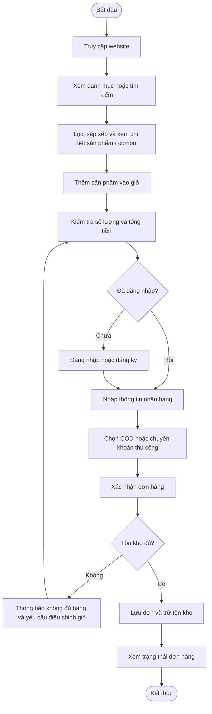
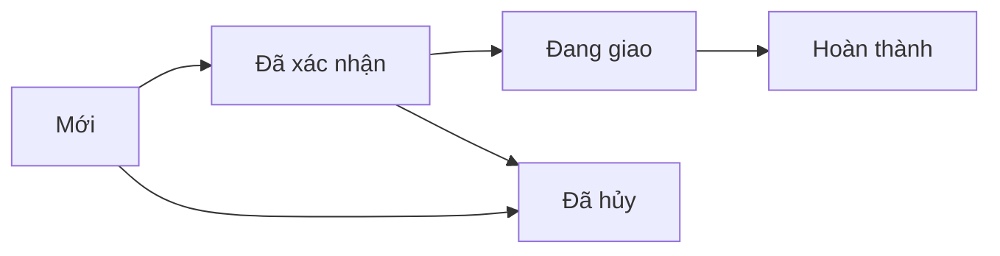
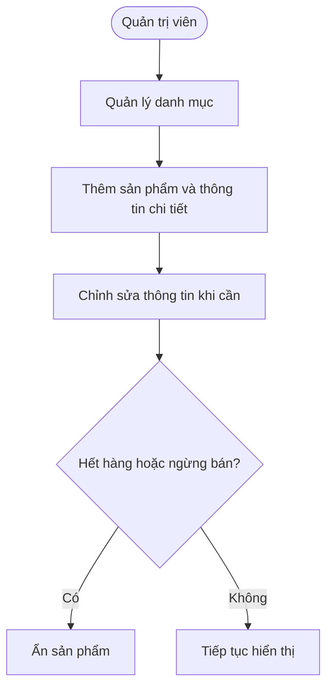
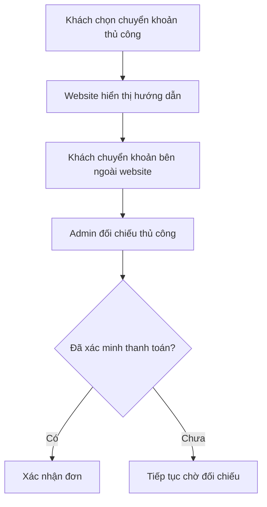

# Quy trình nghiệp vụ chính

> **Dự án:** Website thương mại điện tử bán văn phòng phẩm và phụ kiện trang trí bàn học, bàn làm việc  
> **Ký hiệu:** **[BB]** Bắt buộc · **[XM]** Cần nhóm xác minh/thống nhất

## 1. Quy trình mua hàng [BB]

### 1.1. Các bước thực hiện

1. Khách hàng truy cập website, xem trang chủ, chọn danh mục hoặc tìm kiếm sản phẩm.
2. Khách lọc theo giá và sắp xếp danh sách sản phẩm.
3. Khách xem chi tiết sản phẩm hoặc combo.
4. Khách thêm sản phẩm vào giỏ hàng.
5. Khách kiểm tra số lượng sản phẩm và tổng tiền trong giỏ hàng.
6. Khách đăng nhập hoặc đăng ký tài khoản nếu chưa có.
7. Khách nhập địa chỉ, số điện thoại và chọn hình thức thanh toán **COD** hoặc **chuyển khoản thủ công**.
8. Khách xác nhận đơn hàng; hệ thống kiểm tra tồn kho, lưu đơn và trừ tồn kho khi đặt hàng thành công.
9. Khách xem trạng thái đơn hàng.

### 1.2. Sơ đồ quy trình mua hàng

### 1.3. Quy tắc nghiệp vụ

- Khách phải đăng nhập để đặt hàng.
- Khách có thể điều chỉnh số lượng hoặc xóa sản phẩm khỏi giỏ trước khi đặt hàng.
- Hệ thống phải kiểm tra số lượng tồn kho tại thời điểm xác nhận đặt hàng. Nếu không đủ, thông báo và không tạo đơn thành công.
- Sau khi đặt hàng thành công, đơn được lưu và tồn kho được trừ theo số lượng đặt.

## 2. Quy trình quản trị đơn hàng [BB]

### 2.1. Các bước thực hiện

1. Quản trị viên xem danh sách đơn mới.
2. Kiểm tra thông tin đơn hàng và tình trạng tồn kho.
3. Cập nhật trạng thái đơn theo chiều: **Mới → Đã xác nhận → Đang giao → Hoàn thành**.
4. Chỉ được hủy đơn khi đơn ở trạng thái **Mới** hoặc **Đã xác nhận**. Khi hủy, hệ thống cộng lại tồn kho theo số lượng của đơn. Đơn **Đã hủy** không được khôi phục.

### 2.2. Sơ đồ trạng thái đơn hàng

### 2.3. Quy tắc nghiệp vụ

- Không cho phép chuyển ngược trạng thái đơn hàng trong quy trình thông thường.
- Không cho phép hủy trực tiếp khi đơn ở trạng thái **Đang giao** hoặc **Hoàn thành**.
- Khi hủy hợp lệ, hoàn lại chính xác số lượng tồn kho đã trừ cho đơn hàng; đơn đã hủy không được xử lý tiếp.

## 3. Quy trình quản lý sản phẩm [BB]

Quản trị viên thực hiện:

1. Thêm và quản lý danh mục sản phẩm.
2. Thêm sản phẩm với thông tin: **hình ảnh, giá, số lượng tồn kho, mô tả, chất liệu, kích thước**.
3. Cập nhật thông tin sản phẩm khi có thay đổi.
4. Ẩn sản phẩm khi hết hàng hoặc không còn kinh doanh.

## 4. Quy trình chuyển khoản thủ công [XM]

> **Trạng thái:** Cần nhóm thống nhất cách hiển thị thông tin chuyển khoản và quy trình đối chiếu. **Không sử dụng thông tin tài khoản ngân hàng thật trong repository công khai.**

### Các bước dự kiến

1. Khách chọn **chuyển khoản thủ công** khi đặt hàng.
2. Website hiển thị hướng dẫn/thông tin chuyển khoản phù hợp với phương án nhóm đã thống nhất.
3. Khách thực hiện chuyển khoản ngoài website.
4. Quản trị viên đối chiếu giao dịch **thủ công** và xác nhận đơn theo quy trình quản trị.

### Nội dung cần chốt

- Có hiển thị **thông tin tài khoản mẫu** trên giao diện demo hay không.
- Cách ghi nhận và đối chiếu trạng thái thanh toán thủ công.
- Cách phân biệt **trạng thái thanh toán** với **trạng thái xử lý đơn hàng** nếu có triển khai hai trường riêng.

## 5. Tiêu chí hoàn thành

- Khách hàng có thể thực hiện trọn luồng từ xem sản phẩm đến đặt hàng và theo dõi trạng thái đơn.
- Admin có thể quản lý sản phẩm, danh mục và chuyển trạng thái đơn đúng quy tắc.
- Đặt hàng không vượt số lượng tồn kho; hủy đơn hợp lệ hoàn lại tồn kho.
- Các quy trình bắt buộc **[BB]** có thể được trình diễn và kiểm thử.
- Các điểm **[XM]** được nhóm xác nhận trước khi triển khai.
